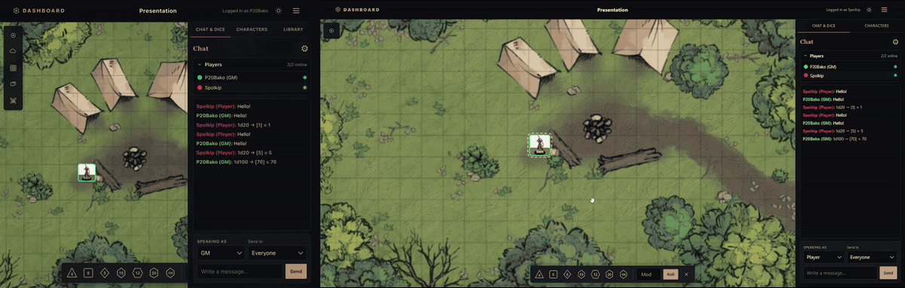
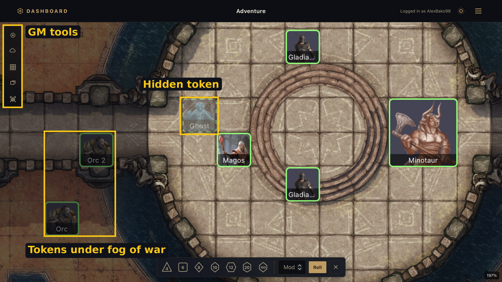
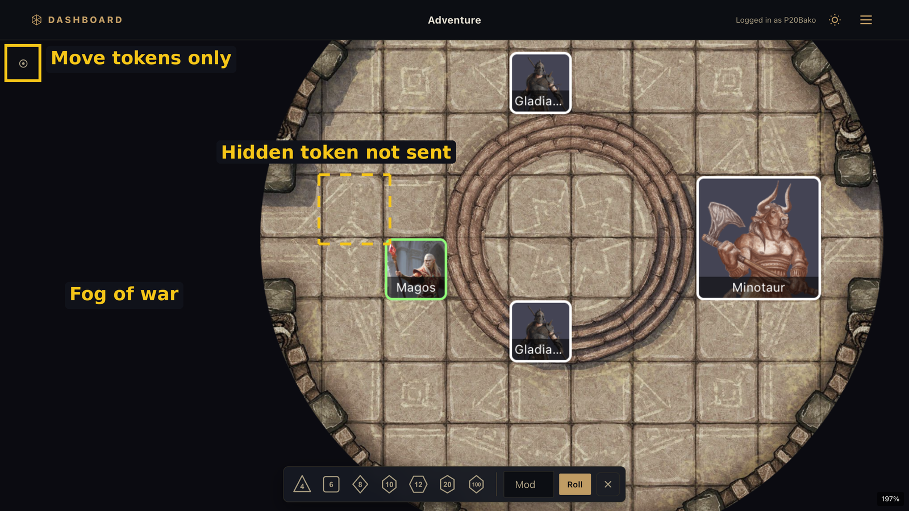
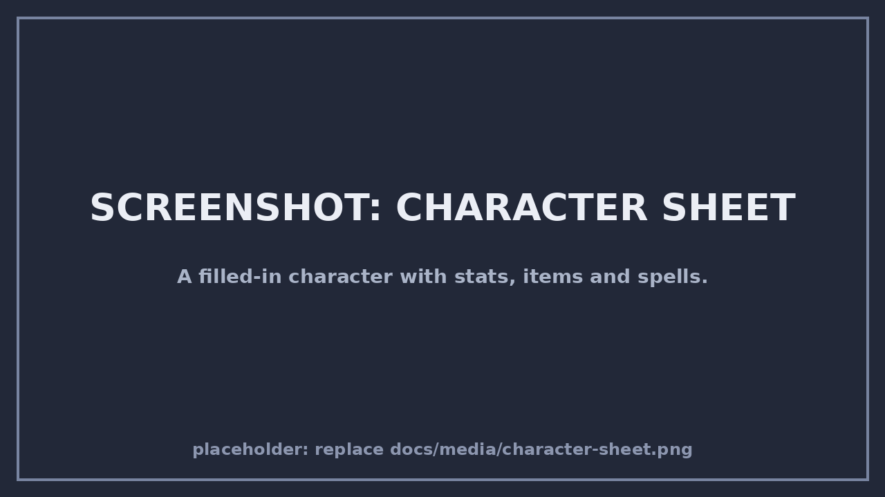
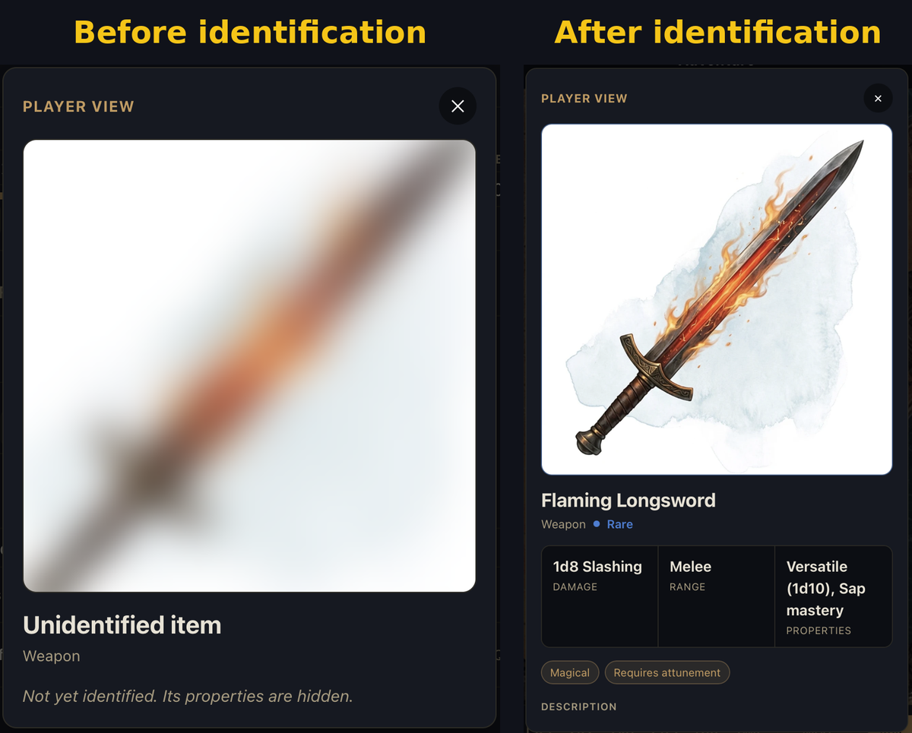
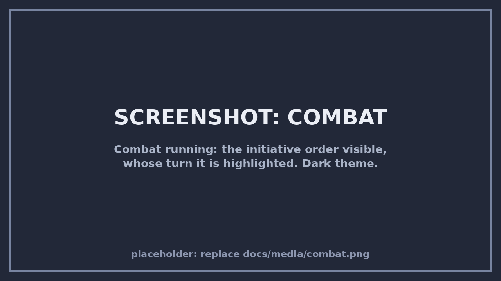
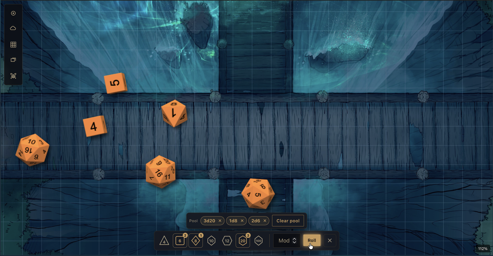
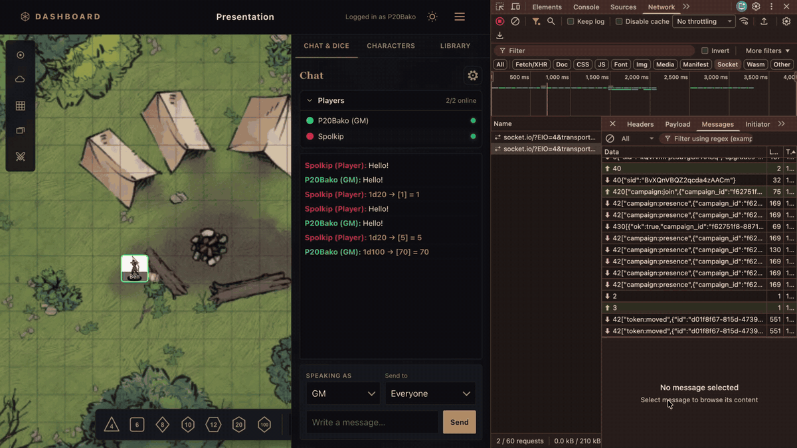

# Virtual Tabletop

A browser app where up to 8 people play a tabletop role-playing game together: a shared map, characters,
dice and turn-based combat, updated live for everyone at the table.

<!-- Uncomment when the live instance is back online:
**Live:** <https://trucksart.com>
-->

## What it does

One player is the **Game Master** (GM), who runs the game. The others play one character each.

- **Shared map** with tokens you drag, and **fog of war** that the GM reveals as the party explores
- **Hidden information:** the server sends each player only what that player may see
- **Character sheets** with stats, skills, items and spells
- **Turn-based combat** with an initiative order and rounds
- **3D dice** and **chat**

| GM view | Player view |
|---|---|
|  |  |

| Character sheet | Items are identified in play |
|---|---|
|  |  |

| Combat | Dice |
|---|---|
|  |  |

Art in the screenshots: battle maps by [Czepeku](https://www.czepeku.com). Pirate portraits and the alligator token: Designed by [Magnific](https://www.magnific.com). Witch portrait from [Pixabay](https://pixabay.com/illustrations/ai-generated-witch-character-game-9461377/).

<!-- TODO: credit the arena map, the arena tokens (Gladiator, Minotaur, Orc, Ghost, Magos), the Flaming Longsword image and the forest map in demo.gif -->

## How it works

- **The server decides.** The browser asks to move a token; the server checks the rules and permissions, saves
  the change and sends it to everyone in that game.
- **Load heavy, update light.** A page loads its data once over a REST API; after that, only changes travel,
  over WebSockets (Socket.IO).
- **Measured, not assumed.** On the production server, a moved token reached every player within
  175–251 ms (95th percentile) with 2 to 50 connections. Before a fix that checks all recipients'
  permissions in one database transaction instead of one each, 10 connections took 3.8 s.

See it in the browser's DevTools: each move is one small WebSocket message

**Stack:** Node.js 22, Express, Socket.IO, PostgreSQL (Knex migrations), vanilla JavaScript, Cloudflare R2 and
Workers.

**Security:** session-based login with Argon2id password hashing, Content Security Policy, rate limiting,
CSRF protection, and private image storage served only to members of the game.

## How it was built

Built as my undergraduate thesis in Informatics at the Ionian University (2026), through **agentic
development**: I wrote the specifications and the project's design decisions, directed AI coding agents
(Claude, ChatGPT), reviewed every change, and released only after the automated tests passed against a real
PostgreSQL database and a check in the browser.

## Documentation

- [Local setup](docs/setup.md) ([Ελληνικά](docs/setup.el.md))
- [Architecture](docs/architecture.md)
- [Testing](docs/testing.md)
- [Deployment](docs/deployment.md)
